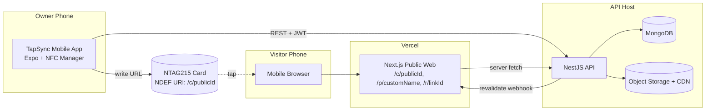
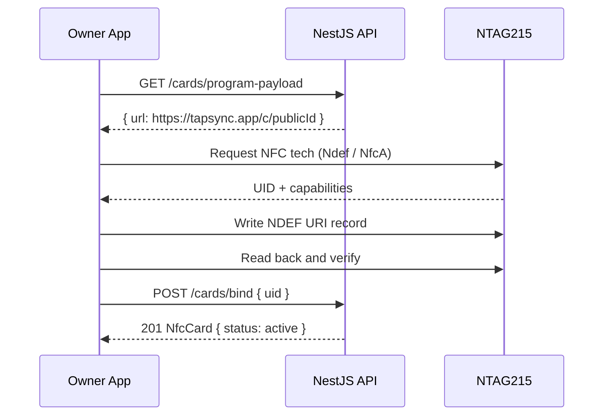
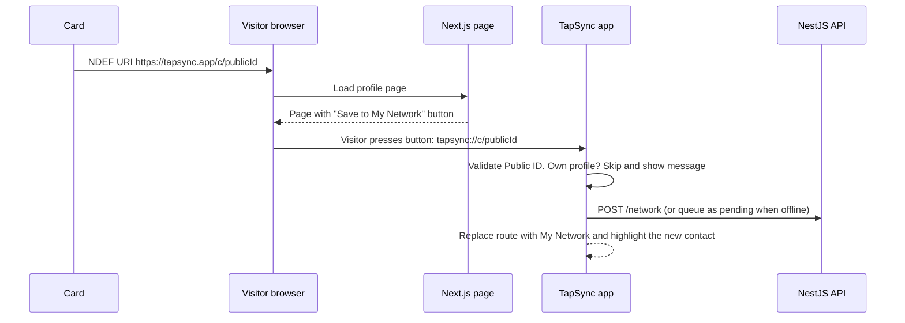

# Design Document

## Overview

TapSync is a three-part system:

1. **Mobile App** (React Native + Expo, dev-client build) — anonymous-first account with optional security/recovery, dashboard, link management, mode toggle, NFC card programming, My Network (saved contacts), analytics.
2. **Backend API** (NestJS + MongoDB/Mongoose) — source of truth for users, links, cards, saved contacts and analytics.
3. **Public Web** (Next.js App Router) — SSR/ISR landing page at `/c/[publicId]` (and optional `/p/[customName]`), vCard route, click/view tracking.

The key design idea: **the NFC card stores only a permanent URL** (`https://tapsync.app/c/{publicId}`) generated automatically at signup. All dynamic behavior (mode, links, profile, even the optional custom name) lives in the cloud and is rendered at request time, so the card never needs rewriting.

### Technology Decisions

| Concern | Choice | Rationale |
|---|---|---|
| Backend | NestJS (TypeScript) | Modular, DI, guards/pipes fit auth + validation |
| Database | MongoDB + Mongoose | Flexible link documents, simple event collections |
| Public page | Next.js App Router, ISR + on-demand revalidation | Fast first paint, instant updates after mode toggle |
| Mobile | Expo (dev client) + `react-native-nfc-manager` | Native NFC read/write; **not usable in Expo Go** |
| Local storage | `expo-sqlite` | Offline queue for pending My Network saves |
| Auth | Anonymous-first accounts; JWT access (15 min) + rotating refresh (sliding 365 days); optional Google, email and recovery code | No sign-up friction, recoverable once linked |
| Images | S3-compatible storage + CDN | Offload avatar delivery |
| Hosting | Vercel (web), Render/DigitalOcean/AWS (API), MongoDB Atlas | Matches spec |

---

## Architecture



### Tap Flow (Visitor)
1. Visitor taps card; phone reads NDEF URI and opens `https://tapsync.app/c/{publicId}`.
2. Next.js serves the cached page (ISR) or renders server-side by calling `GET /public/profiles/c/:publicId`.
3. Page records a view via a non-blocking `POST /public/events` (`navigator.sendBeacon`), or server-side fire-and-forget.
4. Link clicks go through `GET /r/:linkId` (302 redirect that logs the click) or `sendBeacon` before navigation.

> The page also offers a "Save to My Network" button that opens the app. See **My Network and Tap Handling** below.

### Mode Toggle Flow (Owner)
1. App calls `PATCH /user/mode { mode }`.
2. API updates `User.activeMode`, then calls the Next.js revalidation endpoint (`POST /api/revalidate` with shared secret, tag `profile:{publicId}`).
3. Next visitor tap gets fresh HTML. Target: under 2 seconds end-to-end.

### Card Programming Flow (Owner)


---

## Account Model (Anonymous-first)

- **First open:** the app calls `POST /auth/anonymous` with no input. The API creates a credential-less `User` with a generated `publicId`, then returns a short-lived access token (15 min) and a rotating refresh token (sliding 365 days). The app stores the refresh token in `expo-secure-store` and goes straight to the dashboard.
- **Daily use:** silent refresh. There is no login screen.
- **Securing the account:** the Owner can link Google, link email and password (verified by email), and/or generate a recovery code. Any one is a Recovery Method. They attach to the same account, so the page, `publicId`, cards and My Network do not change.
- **Recovery code:** 20 characters from the same look-alike-free alphabet as the Public ID (about 100 bits), shown once in groups of 5, stored only as an Argon2id hash. Regenerating invalidates the previous code.
- **Restore on a new phone:** the first-run screen has "Restore my account". The new phone already has a fresh anonymous session, so the app calls `POST /auth/restore` with that session plus a Google ID token, email and password, or recovery code. The API returns a session for the existing account and deletes the caller's anonymous account if it is untouched (no links, cards or name).
- **Unsecured accounts are single-device:** the refresh token on the phone is the only credential. Losing the phone loses the account. The app shows a warning until a Recovery Method is linked, again after the first card is programmed, and before sign-out.
- **Platform note:** iOS Keychain items can survive an app reinstall, Android secure storage generally does not. Treat this as a convenience, never as recovery.
- **Display name:** optional and blank at first. The public page and vCard use the placeholder "TapSync user" until the Owner sets a name.
- **Abuse protection:** rate limits on `/auth/anonymous` by IP and device, optional Play Integrity / App Attest, and the custom-name change limit.

---

## My Network and Tap Handling

### Web page button + custom link scheme



**The button (`SaveToNetworkButton`, client component)**
- Links to `tapsync://c/{publicId}`. It never fires automatically, because browsers block automatic launches of custom schemes and the Visitor should choose.
- On Android, use an intent link so a missing app falls back to the Play Store: `intent://c/{publicId}#Intent;scheme=tapsync;package=<android package>;S.browser_fallback_url=<encoded Play Store URL>;end`.
- iPhone has no clean fallback. If the app is missing, the custom link fails, so the page always shows a "Get the app" link next to the button. iOS also asks "Open in TapSync?" the first time.
- The page cannot detect whether the app is installed, and stores no Visitor data.

**App side**
- `app.config` sets `scheme: "tapsync"`. Expo Router maps `tapsync://c/abc` to the route `/c/abc`.
- Handlers `app/c/[publicId].tsx` and `app/p/[name].tsx` validate the Public ID format (10 characters from the allowed alphabet), skip the user's own profile, upsert into My Network (`source: 'link'`), then `router.replace('/(tabs)/network')` and highlight the new contact.
- Another app could register the same scheme and intercept the link. The risk is low because the link only carries a public ID.

**Offline:** the page itself needs internet, so with the button flow offline saving happens through the in-app **Scan card** (reads the tag with no internet). The app writes a `pending` row (Public ID, time, source) to local SQLite and syncs it through `POST /network/sync` when connectivity returns or the app comes to the foreground, then refreshes the snapshot from the live profile.

**What the OS allows**

| Situation | What happens | Controllable? |
|---|---|---|
| Any phone, app installed (first version) | Browser opens the page. The visitor presses Save to My Network and the app opens and saves | Yes, with one extra press |
| Any phone, app not installed | The button may fail. The page shows a "Get the app" link (Android can fall back to the Play Store automatically) | Partly |

Verified Universal Links and App Links are not used, so a tap always opens the web page first and the Visitor chooses to open the app.

---

## URL Strategy

| URL | Purpose | Behavior |
|---|---|---|
| `/c/{publicId}` | Permanent URL. The only URL written to cards | Always renders the profile and never changes |
| `/p/{customName}` | Optional vanity URL | Renders the same profile while it is the Owner's current name |
| `/p/{retiredName}` | Former vanity name | Permanent redirect (308) to `/c/{publicId}`; stays reserved to the same Owner |

**Public ID generation**
- 10 characters from a lowercase alphabet without look-alike characters (`23456789abcdefghjkmnpqrstuvwxyz`), generated with `nanoid` `customAlphabet`.
- Generated server-side during registration in the same operation that creates the User. A unique index plus retry on collision guarantees uniqueness.
- Never derived from name or email, and never editable.

**Signup behavior**
- First open needs no input at all: the app creates the account silently (see Account Model). No name, email, password or username.
- The profile starts blank. The public page shows the placeholder name "TapSync user" and the empty state until the Owner adds a name and links.

**Custom name behavior**
- Stored in a `CustomNameClaim` collection so uniqueness covers both current and retired names with one unique index.
- Claim or change runs in a transaction: mark the existing `current` claim as `retired`, insert the new `current` claim, update `User.customName`.
- Removing a name marks the claim `retired` and clears `User.customName`.
- Changes are limited to 3 per 30 days per Owner.
- Both routes use the cache tag `profile:{publicId}`, so one revalidation call refreshes `/c/...` and `/p/...`. Name changes also call `revalidatePath` for the old and new `/p/` paths.
- `/c/{publicId}` is the canonical URL (`<link rel="canonical">`) for both routes.
- Programming a card never uses the custom name, so name changes cannot break cards.

---

## Components and Interfaces

### Backend (NestJS) Modules

| Module | Responsibility |
|---|---|
| `AuthModule` | Anonymous account creation, refresh/logout, Google and email linking, recovery code, restore, JWT strategy and guards |
| `UsersModule` | Profile CRUD, Public ID generation, mode toggle, account deletion |
| `CustomNamesModule` | Claim, change and release custom names; retired-name reservation and redirect lookup |
| `LinksModule` | Link CRUD, reorder, enable/disable, per-mode queries |
| `CardsModule` | Bind/unbind cards, list cards, UID uniqueness |
| `PublicModule` | Read-only public profile endpoint, vCard generation |
| `AnalyticsModule` | Event ingestion, aggregation queries, bot filtering |
| `NetworkModule` | My Network save, sync, list, private notes, snapshot refresh |
| `MediaModule` | Avatar upload, validation, resize, storage |
| `RevalidationService` | Calls Next.js revalidation webhook on any public-affecting change |
| `CommonModule` | Pipes, interceptors, exception filter, throttler config, config validation |

### REST API

**Auth**
| Method | Path | Description |
|---|---|---|
| POST | `/auth/anonymous` | First open: create anonymous account, profile and Public ID. Returns tokens |
| POST | `/auth/refresh` | Rotate refresh token |
| POST | `/auth/logout` | Invalidate refresh token |
| POST | `/auth/link/google` | Link Google to the current account |
| POST | `/auth/link/email` | Link email and password. Sends verification |
| POST | `/auth/verify-email` | Confirm email |
| POST | `/auth/recovery-code` | Generate or regenerate the recovery code (shown once) |
| POST | `/auth/restore` | Body: Google ID token, or email and password, or recovery code. Restores an existing account |

**User / Profile**
| Method | Path | Description |
|---|---|---|
| GET | `/user/me` | Current profile, active mode |
| PATCH | `/user/me` | Update profile fields |
| POST | `/user/me/avatar` | Upload avatar |
| PATCH | `/user/mode` | Body `{ mode: "work" \| "casual" }` |
| GET | `/user/custom-name/available?name=` | Custom name availability check |
| PUT | `/user/custom-name` | Claim or change custom name |
| DELETE | `/user/custom-name` | Remove custom name (old name keeps redirecting) |
| DELETE | `/user/me` | Account deletion |

**Links**
| Method | Path | Description |
|---|---|---|
| GET | `/links?mode=` | List own links |
| POST | `/links` | Create |
| PATCH | `/links/:id` | Update (incl. enable/disable) |
| PUT | `/links/reorder` | Body `{ mode, orderedIds[] }` |
| DELETE | `/links/:id` | Delete |

**Cards**
| Method | Path | Description |
|---|---|---|
| GET | `/cards/program-payload` | Returns `https://tapsync.app/c/{publicId}` |
| POST | `/cards/bind` | Body `{ uid }`, binds card to user |
| GET | `/cards` | List own cards |
| DELETE | `/cards/:id` | Unassign card |

**My Network (auth)**
| Method | Path | Description |
|---|---|---|
| GET | `/network?search=&cursor=` | List saved contacts, most recent tap first |
| POST | `/network` | Idempotent save by `publicId` (`source`, `tappedAt`) |
| POST | `/network/sync` | Bulk upsert of pending offline entries |
| PATCH | `/network/:id` | Edit private note |
| DELETE | `/network/:id` | Remove contact |

**Public (no auth, rate limited)**
| Method | Path | Description |
|---|---|---|
| GET | `/public/profiles/c/:publicId` | Profile + enabled links for active mode |
| GET | `/public/profiles/p/:name` | Current custom name returns the profile; retired name returns `{ redirectTo }`; otherwise 404 |
| GET | `/public/profiles/c/:publicId/vcard` | vCard file |
| POST | `/public/events` | Record view / click / contact-save |
| GET | `/r/:linkId` | Logs click then 302 to target (served via web or API) |

**Analytics (auth)**
| Method | Path | Description |
|---|---|---|
| GET | `/analytics/summary?range=` | Totals |
| GET | `/analytics/links?range=` | Per-link click counts |
| GET | `/analytics/recent?limit=` | Recent events |

### Public Web (Next.js)

```
app/
  c/[publicId]/page.tsx        # canonical SSR/ISR profile page (server component)
  p/[name]/page.tsx            # current custom name: same page; retired name: 308 to /c/{publicId}
  c/[publicId]/vcard/route.ts  # proxies vCard from API with correct headers
  r/[linkId]/route.ts          # click logger + redirect
  api/revalidate/route.ts      # secret-protected revalidateTag
  not-found.tsx
components/
  ProfileHeader, LinkCard, SaveContactButton, SaveToNetworkButton, ThemeProvider
lib/
  api.ts                       # server fetch with tags: [`profile:${publicId}`]
```

Rendering notes:
- Use `fetch(url, { next: { tags: [`profile:${publicId}`], revalidate: 60 } })` plus on-demand `revalidateTag`.
- Keep the page as a server component; only `SaveContactButton`, `SaveToNetworkButton` and the tracking beacon are client components.
- Use `next/image` for avatar with explicit dimensions; inline critical CSS; system font stack.

### Mobile App (Expo)

```
src/
  app/ (expo-router)
    welcome              # first run, small "Restore my account" link
    c/[publicId], p/[name]   # link handlers (custom scheme): save to My Network, then open (tabs)/network
    (tabs)/home          # mode toggle + quick stats
    (tabs)/links         # list, add/edit, reorder, enable/disable
    (tabs)/card          # program / manage cards
    (tabs)/network       # My Network list, contact detail, scan card / QR / paste link
    (tabs)/analytics
    (tabs)/profile       # profile, custom name, Secure your account
  features/
    auth/      (anonymous bootstrap, secure token storage via expo-secure-store, linking and restore)
    links/
    nfc/       (useNfcWriter hook, NfcService)
    analytics/
    network/   (expo-sqlite pending queue, sync, My Network hooks)
  lib/api.ts   (axios/fetch + refresh interceptor)
  state/       (React Query for server state, Zustand for UI state)
```

**NFC service interface**

```ts
type NfcWriteState =
  | { status: 'idle' }
  | { status: 'unsupported' }
  | { status: 'disabled' }
  | { status: 'waiting' }                 // awaiting tag
  | { status: 'writing' }
  | { status: 'verifying' }
  | { status: 'success'; uid: string }
  | { status: 'error'; code: NfcErrorCode; message: string };

type NfcErrorCode =
  | 'TIMEOUT' | 'TAG_LOST' | 'NOT_WRITABLE' | 'TOO_SMALL'
  | 'VERIFY_FAILED' | 'USER_CANCELLED' | 'ALREADY_BOUND' | 'UNKNOWN';

interface NfcService {
  isSupported(): Promise<boolean>;
  isEnabled(): Promise<boolean>;
  writeProfileUrl(url: string, opts?: { timeoutMs?: number }): Promise<{ uid: string }>;
  cancel(): Promise<void>;
}
```

Implementation notes:
- Use `NfcManager.requestTechnology(NfcTech.Ndef)`, `Ndef.uriRecord(url)` and `ndefHandler.writeNdefMessage`.
- Read back with `getNdefMessage()` and compare decoded URI.
- A short URL (~35 bytes) fits easily within NTAG215's 504-byte memory. Use the `https://` URI prefix code for compact encoding.
- iOS needs the `NFCReaderUsageDescription` Info.plist entry, the NFC Tag Reading capability, and `com.apple.developer.nfc.readersession.formats` entitlement. Android needs `android.permission.NFC`.
- Default write timeout: 20 s.

---

## Data Models

### User
```ts
{
  _id: ObjectId,
  email?: string,             // only when the user links email. Unique sparse, lowercased
  emailVerified: boolean,     // default false
  passwordHash?: string,      // only when email is linked
  googleId?: string,          // unique sparse. Only when Google is linked
  recoveryCodeHash?: string,  // Argon2id hash of the recovery code
  publicId: string,           // immutable, unique, generated at signup
  customName?: string,        // optional vanity name; mirrors the current CustomNameClaim
  fullName?: string,          // optional. Blank until the Owner sets it (page shows placeholder)
  bio?: string,               // max 280
  designation?: string,
  company?: string,
  phone?: string,
  publicEmail?: string,
  hiddenFields: ('phone' | 'publicEmail')[],
  avatarUrl?: string,
  activeMode: 'work' | 'casual',   // default 'work'
  theme?: 'light' | 'dark' | 'system',
  status: 'active' | 'suspended' | 'deleted',
  refreshTokenHashes: { hash: string, expiresAt: Date, deviceId?: string }[],
  createdAt: Date, updatedAt: Date
}
// Indexes: { email: 1 } unique sparse, { publicId: 1 } unique, { googleId: 1 } unique sparse
```
> The spec's `User.cardId` is replaced by the `NfcCard.mappedUserId` relation to support multiple cards per user.
> A User with no verified email, no `googleId` and no `recoveryCodeHash` is an *unsecured* account (single-device).

### CustomNameClaim
```ts
{
  _id: ObjectId,
  name: string,               // lowercased, unique across ALL claims (current and retired)
  userId: ObjectId,
  status: 'current' | 'retired',
  claimedAt: Date,
  retiredAt?: Date
}
// Indexes: { name: 1 } unique, { userId: 1, status: 1 }
// Rate limit: max 3 changes per 30 days per user, checked from claimedAt
```

### NetworkContact
```ts
{
  _id: ObjectId,
  ownerUserId: ObjectId,       // the user whose My Network this is
  publicId: string,            // the saved profile's Public ID
  targetUserId?: ObjectId,     // resolved when online
  status: 'saved' | 'unavailable',   // 'pending' exists only in the app's local store until synced
  snapshot?: { name?: string, designation?: string, avatarUrl?: string },
  source: 'nfc' | 'qr' | 'link' | 'scan',
  modeAtSave?: 'work' | 'casual',
  note?: string,               // private to the owner
  tapCount: number,
  firstSavedAt: Date,
  lastTappedAt: Date
}
// Indexes: { ownerUserId: 1, publicId: 1 } unique, { ownerUserId: 1, lastTappedAt: -1 }
// The profile owner has no read access to this collection.
```

### ProfileLink
```ts
{
  _id: ObjectId,
  userId: ObjectId,
  mode: 'work' | 'casual',
  title: string,
  url: string,
  icon: string,               // key from icon registry, or 'custom'
  category: string,           // 'linkedin' | 'github' | 'instagram' | ... | 'custom'
  priorityOrder: number,
  isEnabled: boolean,
  clickCount: number,         // denormalized counter
  createdAt: Date, updatedAt: Date
}
// Index: { userId: 1, mode: 1, priorityOrder: 1 }
```

### NfcCard
```ts
{
  _id: ObjectId,
  uid: string,                // hex, uppercase, unique
  mappedUserId: ObjectId | null,
  status: 'active' | 'unassigned',
  label?: string,
  lastProgrammedAt?: Date,
  createdAt: Date, updatedAt: Date
}
// Indexes: { uid: 1 } unique, { mappedUserId: 1 }
```

### AnalyticsEvent
```ts
{
  _id: ObjectId,
  userId: ObjectId,
  type: 'view' | 'link_click' | 'contact_save',
  mode: 'work' | 'casual',
  linkId?: ObjectId,
  occurredAt: Date,
  country?: string,           // from edge geo header
  deviceType?: 'ios' | 'android' | 'desktop' | 'other',
  referrer?: string,
  sessionHash?: string        // salted daily hash, not reversible to IP
}
// Indexes: { userId: 1, occurredAt: -1 }, { userId: 1, type: 1, occurredAt: -1 }
// TTL index on occurredAt (e.g. 400 days)
```

### Public Profile DTO (API to Next.js)
```ts
{
  publicId, customName?, fullName, designation?, company?, bio?, avatarUrl?,
  contact: { phone?, email? },          // already filtered by hiddenFields
  mode: 'work' | 'casual',
  links: { id, title, url, icon, category }[]   // enabled only, sorted by priorityOrder
}
```

---

## Platform Limitations

| Topic | Reality | Design response |
|---|---|---|
| Visitor offline | The phone reads the URL from the card, but the page and its links need internet | No offline mode. The in-app help states this |
| Prompt vs instant redirect | The visitor's OS decides. iPhone XS/XR and newer show a banner the user taps; Android varies by brand and settings | Not controllable. The tap opens the web page, where the Save to My Network button opens the app |
| Visitor has no app | The page opens in the phone's browser | Page shows the Save to My Network button with a "Get the app" link beside it. It stores nothing |
| Older iPhones / NFC off | Older iPhones need an NFC reader app or Control Center tile; Android needs NFC enabled | Listed in the in-app help |
| Saving a tap without opening the app | Not possible. iOS runs no app code until the user taps the banner, and the web page cannot save anything for a Visitor | The Visitor presses Save to My Network or uses Scan card |

---

## Error Handling

| Layer | Strategy |
|---|---|
| API | Global exception filter returning `{ statusCode, code, message, details? }`; class-validator + `ValidationPipe({ whitelist: true, forbidNonWhitelisted: true })` |
| Auth | Generic message for bad credentials; 401 vs 403 clearly separated; refresh-token reuse detection revokes the token family |
| Public web | `not-found.tsx` for unknown/suspended users; error boundary showing cached content if API is down |
| Analytics | Fire-and-forget; failures logged, never surfaced to visitor |
| Mobile | React Query retry with backoff; global toast for network errors; NFC errors mapped to `NfcErrorCode` with human-readable messages and a retry action |
| Revalidation | If webhook fails, retry up to 3 times with backoff; page still falls back to 60 s ISR window |

Common HTTP codes: `400` validation, `401` unauthenticated, `403` forbidden, `404` not found, `409` conflict (email/custom name/card UID), `429` rate limited.

---

## Security Design

- Argon2id password hashing; JWT secrets from environment; refresh tokens stored hashed and rotated.
- Anonymous accounts: the refresh token is the only credential until a Recovery Method is linked. It lives in secure storage only. `/auth/anonymous` is rate limited, with optional Play Integrity / App Attest.
- Recovery codes: about 100 bits, Argon2id-hashed, shown once, restore attempts throttled.
- My Network is private to its owner. No endpoint lets a profile owner see who saved them.
- `helmet`, strict CORS (web origin + mobile), `@nestjs/throttler` (stricter on `/auth/*` and `/public/events`).
- URL allow-list for link schemes; escape all rendered text; no `dangerouslySetInnerHTML`.
- Revalidation endpoint protected by a shared secret header; compared in constant time.
- Analytics stores no raw IPs; uses salted daily hash for session de-duplication.
- Optional NTAG215 password protection (`PWD_AUTH`) as a later enhancement; default is unlocked so cards can be re-programmed.
- Cloning risk: because the card only holds a public URL, cloning it exposes nothing beyond the public profile. Card UID is recorded for ownership, not authentication.

---

## Testing Strategy

| Level | Tools | Scope |
|---|---|---|
| Unit (API) | Jest | Services, validators, vCard builder, mode logic, bot filter |
| Integration (API) | Jest + Supertest + `mongodb-memory-server` | Auth flows, link CRUD ownership checks, card binding conflicts, public DTO filtering |
| Unit (Web) | Vitest / Jest + React Testing Library | Components, theme, empty states |
| E2E (Web) | Playwright | `/c/[publicId]` and `/p/[customName]` render, retired-name redirect, mode change reflected after revalidation, 404s, vCard download |
| Mobile unit | Jest + React Native Testing Library | Hooks, NFC state machine (mock `react-native-nfc-manager`) |
| Manual device | Real NTAG215 cards on Android and iOS | Write, read-back, tap-to-open, re-program, failure paths (tag removed, read-only tag) |
| App link button | Real iPhone and Android, with and without the app installed | Save to My Network button opens My Network, Android Play Store fallback, offline pending save, own-card skip, restore flow |
| Performance | Lighthouse CI, k6 | LCP, JS size, public endpoint p95 |
| Accessibility | axe, manual VoiceOver/TalkBack pass | Public page |

vCard acceptance: import generated `.vcf` on one iOS and one Android device; include a test case with non-ASCII names and commas in the company name.

---

## Deployment

- **Monorepo** (pnpm workspaces): `apps/api`, `apps/web`, `apps/mobile`, `packages/shared` (DTO types, constants such as reserved custom names and mode enum).
- **CI** (GitHub Actions): lint, typecheck, test on PR; deploy `web` to Vercel and `api` to Render/DigitalOcean on `main`.
- **Environments**: `dev`, `staging`, `prod`, each with separate MongoDB database and secrets.
- **Mobile builds**: EAS Build for `.apk` / `.aab` and `.ipa`; internal distribution for testers (TestFlight / Android internal track).
- **Domain**: `tapsync.app` to Vercel; `api.tapsync.app` to the API host.
- **Observability**: structured logging (pino), Sentry for API, web and mobile, uptime check on `/health`.
